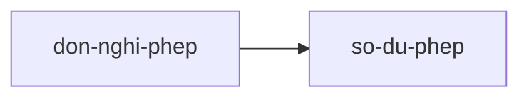
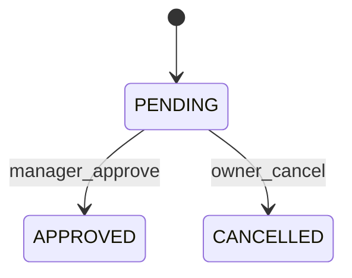
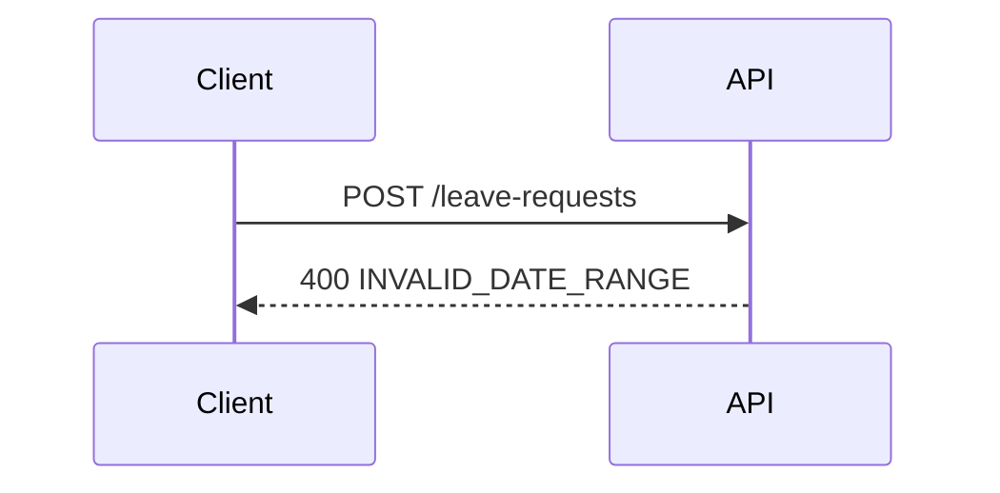

# Quy ước chung

Mọi skill `ba-*` tuân theo file này. Mâu thuẫn giữa skill và file này thì theo file này.

## Workspace
- Gốc: `ba-workspace/<slug>/` tại thư mục làm việc hiện tại.
- Không có `<slug>`: nếu `ba-workspace/` có đúng một thư mục con thì dùng nó, nhiều hơn thì hỏi, không đoán.

## ID (ổn định, không đánh lại số, không tái sử dụng)
`RAW-nnn` yêu cầu thô · `BR-nnn` mục tiêu nghiệp vụ · `US-nnn` story · `FR-nnn` yêu cầu chức năng · `NFR-nnn` phi chức năng · `Q-nnn` câu hỏi mở · `CR-nnn` thay đổi · `TC-nnn-mm` test case (nnn = số US, mm = thứ tự).
**Scenario ID**: mỗi scenario trong story có ID `US-012/S1`, `S2`... viết ngay trong tên scenario: `Scenario: [US-012/S1] <tên>`. Test case và báo cáo dựa vào ID này. Story cũ chưa có thì bổ sung, không đổi nội dung scenario.

## Trạng thái module (`01-backbone/status.md`)
Cột: `module | owner | branch | trạng thái | cập nhật | verdict gần nhất`.
Giá trị trạng thái, chỉ dùng đúng các chữ này:
`Chưa nhận` → `Đang soạn` → `Chờ review` → `Đã duyệt`; từ `Chờ review`/`Đã duyệt` có thể về `Cần sửa` (review trượt hoặc có CR), rồi `Đang soạn` lại.

## traceability.csv
Một dòng cho mỗi liên kết, cột cố định, ô chưa có để trống:

`RAW-ID,BR-ID,module,US-ID,FR-ID,NFR-ID,TC-ID`

- backbone: tạo dòng `RAW,BR,module,,,,`.
- stories: mỗi US thêm dòng (sao chép RAW/BR/module nguồn) với `US-ID`.
- spec: điền `FR-ID`/`NFR-ID` vào dòng cùng `US-ID`; một US có nhiều FR thì thêm dòng.
- tests: điền `TC-ID` vào dòng cùng `US-ID`; một US có nhiều TC thì thêm dòng.
- File cũ thiếu cột `TC-ID` thì thêm cột (rỗng) khi ghi lần đầu. Không xóa dòng. RAW ngoài phạm vi để `module=OUT-OF-SCOPE`.
- Ghi CSV bằng `python3` (module `csv`) để ô có dấu phẩy được quote đúng, luôn `csv.writer(f, lineterminator="\n")` và `open(..., newline="", encoding="utf-8")` (mặc định của `csv` là CRLF, lẫn với dòng thêm bằng `echo` và làm Git báo đổi dòng).
- RAW/BR toàn hệ thống (phi chức năng, ràng buộc chung): để `module=ALL`. NFR của chúng nằm trong SRS của **module chủ NFR**, được `backbone` đánh dấu `(chủ NFR)` trong `modules.md`; chỉ có đúng một module như vậy.

## Test case (`modules/<module>/tests/test-cases.csv`)
Cột: `TC-ID,US-ID,Scenario,Loại,Ưu tiên,Tiền điều kiện,Bước,Dữ liệu,Kết quả mong đợi,Ghi chú`.
Mã loại (chỉ dùng bảng này): `HP` happy · `BV` biên · `ER` lỗi/không hợp lệ · `AZ` phân quyền · `ST` trạng thái · `DI` toàn vẹn dữ liệu · `PF` hiệu năng. Ưu tiên: `P1`, `P2`, `P3`.

## Severity (consistency, gate)
**H** mâu thuẫn số liệu/quy tắc hoặc đứt chuỗi truy vết · **M** thiếu đối ứng (US không có FR, FR không có endpoint, trường API không có thuộc tính) · **L** đặt tên/thuật ngữ.

## baselines.csv (`ba-workspace/<slug>/baselines.csv`)
`path,sha256,version,approved_by,date` — `path` tương đối so với `ba-workspace/<slug>/`. Chỉ thêm dòng, không sửa dòng cũ; bản mới của cùng `path` là dòng sau cùng (version tăng). Tạo bằng `sha256sum`, không tự bịa hash.
Hook `guard` của plugin hỏi xác nhận trước khi sửa file có trong danh sách này.

## events.csv (`ba-workspace/<slug>/events.csv`)
Nhật ký chỉ-thêm-dòng, nguồn dữ liệu cho retro. Cột `date,event,module,detail`; `detail` không chứa dấu phẩy. Ghi bằng lệnh sau (tạo header nếu chưa có):

```
[ -f ba-workspace/<slug>/events.csv ] || echo 'date,event,module,detail' > ba-workspace/<slug>/events.csv
echo "$(date +%F),<event>,<module>,<detail>" >> ba-workspace/<slug>/events.csv
```

| event | do skill nào ghi | detail |
|---|---|---|
| `claim` | collab | tên người nhận |
| `status` | collab, impact | `từ>đến` (vd `Đang soạn>Chờ review`) |
| `gate` | gate | `VERDICT;điểm;số lỗi cứng` |
| `flow` | flow | `phủ%;số sơ đồ` |
| `tests` | testgen | `phủ%;số TC` |
| `check` | consistency | `H;M;L` (số lỗi còn lại) |
| `cr` | impact | `CR-nnn` |
| `q-open`, `q-close` | intake và bước đóng câu hỏi | `Q-nnn` |
| `export` | export, confluence | `đích;số mục` |
| `checkpoint` | checkpoint | nhãn |

Sự kiện không thuộc module nào (intake, package, export toàn dự án) để cột `module` là `-`. Thiếu sự kiện thì ghi thiếu, không suy đoán thay.

## Bộ diagram (tối đa 5 loại; chỉ Mermaid)
Chỉ vẽ khi sơ đồ chứa thông tin mà bảng/văn bản không nói rõ bằng. Mỗi sơ đồ ≤ 15 nút (quá thì tách theo quy trình con), trả lời đúng một câu hỏi, và mọi phần tử gắn ID nguồn (`US-001/S1`, `FR-005`, endpoint). Không vẽ sơ đồ lớp, deployment, activity trùng flow, hay sơ đồ riêng cho từng story.

| # | Diagram | File | Vẽ khi | Quy ước để máy kiểm |
|---|---|---|---|---|
| D0 | Bản đồ module (`flowchart LR`) | `01-backbone/process-flows.md` | luôn | nút là slug module; mũi tên = phụ thuộc, khớp cột "Phụ thuộc" của `modules.md` |
| D1 | Luồng swimlane (`flowchart`, `subgraph` theo actor) | `spec/flows.md` | mỗi quy trình nghiệp vụ | nút gắn `[US-nnn/Sn]`/`[FR-nnn]`; gọi module khác viết `→ <slug>` |
| D2 | Máy trạng thái (`stateDiagram-v2`) | `spec/flows.md` | thực thể có trường trạng thái ≥ 3 giá trị | tên trạng thái là mã enum không dấu cách (`PENDING`); mũi tên `A --> B: sự kiện` |
| D3 | Trình tự (`sequenceDiagram`, ≤ 8 thông điệp) | `spec/flows.md` | bước vượt ranh giới: module khác, hệ thống ngoài, bất đồng bộ | thông điệp ghi `METHOD /path` đúng như bảng API của SRS, kèm mã lỗi nhánh chính |
| D4 | ER (`erDiagram`) | `spec/srs.md` | module sở hữu dữ liệu | cạnh có bội số; ngay dưới sơ đồ có dòng `enum status: PENDING \| APPROVED \| ...`; thực thể của module khác chỉ là stub |

Không đủ điều kiện kích hoạt thì ghi vào mục "Không vẽ" của `flows.md` kèm lý do. Mẫu tối thiểu:




Test case cho chuyển trạng thái (`ST`) ghi `ST:PENDING>APPROVED` ở cột Ghi chú; chuyển không hợp lệ bị từ chối ghi `ST:APPROVED>PENDING!`.

## Từ mơ hồ (không có số đo thì không được vào story/spec)
nhanh, chậm, dễ dùng, thân thiện, linh hoạt, vài, nhiều, ít, sớm, kịp thời, an toàn, ổn định, hiệu quả, dễ mở rộng, phù hợp, tương tự, v.v., nếu cần, các loại, "và các..." .

## Nguyên tắc làm việc
- Không bịa. Nguồn không nói thì ghi `open-questions.md` với Q-ID; suy luận của bạn đánh dấu `[suy luận]`, giả định `[giả định: Q-xxx]`, chưa kiểm chứng `[chưa xác minh]`.
- Con số, đếm, phần trăm: tính bằng lệnh (`grep -c`, `awk`, `python3`), không tính nhẩm.
- Ghi remote (push, gửi tin, đăng Confluence) luôn cần người dùng xác nhận từng lần. Không nhập, hiển thị hay lưu token/mật khẩu; xác thực dịch vụ ngoài qua MCP (`/mcp`).
- Cổng bàn giao: mọi lệnh `export` áp dụng đúng phần "Trước khi đóng gói" của `ba-package` (module chưa `Đã duyệt` hoặc file lệch baseline chỉ xuất khi người dùng xác nhận, và đánh dấu `NHÁP`).
- Kết thúc mỗi bước: liệt kê file đã tạo/sửa, số liệu chính, và lệnh gợi ý cho bước kế.
